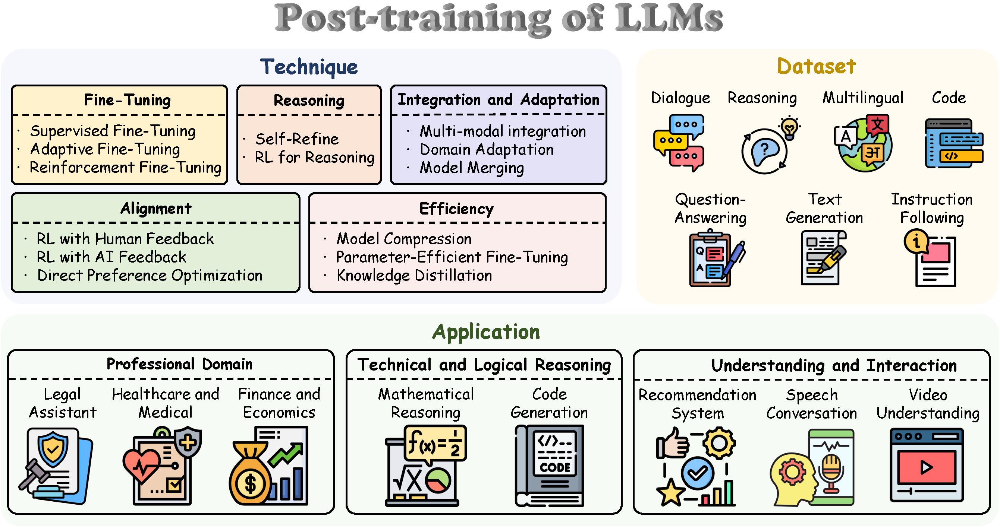
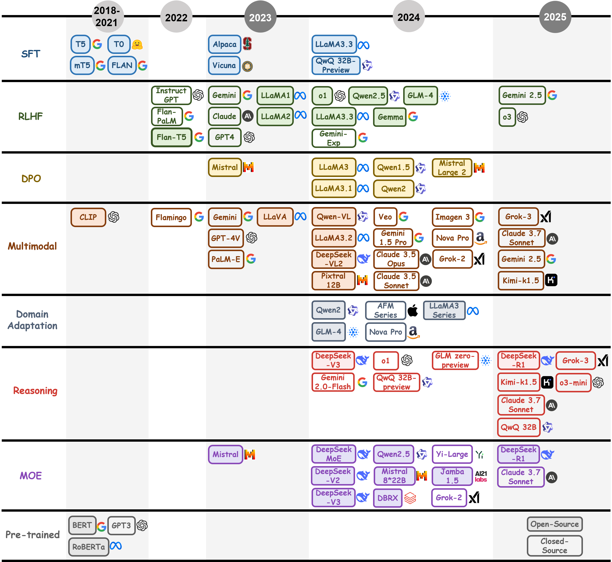

# Large Language Models Post-training: Surveying Techniques from Alignment to Reasoning


[](https://arxiv.org/pdf/2503.06072)

<p align="center">
    
</p>

Welcome to the **LLM-Post-training-Survey** repository! This repository is a curated collection of the most influential Fine-Tuning, alignment, reasoning, and efficiency related to **Large Language Models (LLMs) Post-Training  Methodologies**. 

Our work is based on the following paper:  
📄 **Large Language Models Post-training: Surveying Techniques from Alignment to Reasoning** – Available on [](https://arxiv.org/pdf/2503.06072)

- **Corresponding authors:** [Guiyao Tie](mailto:tgy@hust.edu.cn), [Zeli zhao](mailto:zhaozeli@hust.edu.cn).  

Feel free to ⭐ star and fork this repository to keep up with the latest advancements and contribute to the community.

---

<p align="center">
  
<!--    -->
</p>

Structural overview of post-training techniques surveyed in this study, illustrating the organization of methodologies, datasets, and applications.

---

<p align="center">
  
<!--    -->
</p>

Timeline of post-training technique development for Large Language Models(2018–2025), delineating key milestones in their historical progression

---

## 📌 Contents  

| Section                                                      | Subsection                                                   |
| ------------------------------------------------------------ | ------------------------------------------------------------ |
| [🤖 PoLMs for Fine-Tuning](#PoLMs-for-Fine-Tuning)            | [Supervised Fine-Tuning](#Supervised-Fine-Tuning), [Adaptive Fine-Tuning](#Adaptive-Fine-Tuning), [Reinforcement Fine-Tuning](#Reinforcement-Fine-Tuning) |
| [🏆 PoLMs for Alignment](#PoLMs-for-Alignment)                | [Reinforcement Learning with Human Feedback](#Reinforcement-Learning-with-Human-Feedback), [Reinforcement Learning with AI Feedback](#Reinforcement-Learning-with-AI-Feedback), [Direct Preference Optimization](#Direct-Preference-Optimization) |
| [🚀 PoLMs for Reasoning](#PoLMs-for-Reasoning)                | [Self-Refine for Reasoning](#Self-Refine-for-Reasoning), [Reinforcement Learning for Reasoning](#Reinforcement-Learning-for-Reasoning) |
| [🧠 PoLMs for Efficiency](#PoLMs-for-Efficiency)              | [Model Compression](#Model-Compression), [Parameter-Efficient Fine-Tuning](#Parameter-Efficient-Fine-Tuning), [Knowledge-Distillation](#Knowledge-Distillation) |
| [🌀 PoLMs for Integration and Adaptation](#PoLMs-for-Integration-and-Adaptation) | [Multi-Modal Integration](#Multi-Modal-Integration), [Domain Adaptation](#Domain-Adaptation), [Model Merging](#Model-Merging) |
| [🤝 Datasets](#Datasets)                                      | [Human-Labeled Datasets](#Human-Labeled-Datasets), [Distilled Dataset](#Distilled-Dataset), [Synthetic Datasets](#Synthetic-Datasets) |
| [📚 Applications](#Applications)                              | [Professional Domains](#Professional-Domains), [Technical and Logical Reasoning](#Technical-and-Logical-Reasoning), [Understanding and Interaction](Understanding-and-Interaction) |

---

# 📖 Papers  


## 🤖 PoLMs for Fine-Tuning  

Fine-tuning constitutes a cornerstone of adapting pre-trained Large Language Models (LLMs) to specialized tasks, refining their capabilities through targeted parameter adjustments. This process leverages labeled or task-specific datasets to optimize performance, bridging the gap between general-purpose pre-training and domain-specific requirements. This chapter explores three principal fine-tuning paradigms: Supervised Fine-Tuning, which employs annotated datasets to enhance task-specific accuracy; Adaptive Fine-Tuning, which customizes model behavior via instruction tuning and prompt-based methods; and Reinforcement Fine-Tuning, which integrates reinforcement learning to iteratively refine outputs based on reward signals, fostering continuous improvement through dynamic interaction.

### Supervised Fine-Tuning

- LLaMA: Open and efficient foundation language models [Paper](https://arxiv.org/abs/2302.13971)   
- GPT-4 technical report [Paper](https://arxiv.org/abs/2303.08774)   
- Beyond Goldfish Memory: Long-Term Open-Domain Conversation [Paper](https://aclanthology.org/2022.acl-long.356/)   
- Don't stop pretraining: Adapt language models to domains and tasks [Paper](https://arxiv.org/abs/2004.10964)   
- Exploring the limits of transfer learning with a unified text-to-text transformer [Paper](https://arxiv.org/abs/1910.10683)   
- BERT: Pre-training of deep bidirectional transformers for language understanding [Paper](https://arxiv.org/abs/1810.04805)   
- Mixed precision training [Paper](https://arxiv.org/abs/1710.03740)   
- Training deep nets with sublinear memory cost [Paper](https://arxiv.org/abs/1604.06174)   
- Learning word vectors for sentiment analysis [Paper](https://aclanthology.org/P11-1015/)   

### Adaptive Fine-Tuning

- Instruction Mining: High-Quality Instruction Data Selection for Large Language Models [Paper](https://arxiv.org/abs/2407.16493)   
- Instruction Tuning for Large Language Models: A Survey [Paper](https://arxiv.org/abs/2308.10792)   
- Self-instruct: Aligning language model with self generated instructions [Paper](https://arxiv.org/abs/2212.10560)   
- Chain-of-thought prompting elicits reasoning in large language models [Paper](https://arxiv.org/abs/2201.11903)   
- LoRA: Low-Rank Adaptation of Large Language Models [Paper](https://arxiv.org/abs/2106.09685)   
- Prefix-tuning: Optimizing continuous prompts for generation [Paper](https://arxiv.org/abs/2101.00190)   
- Finetuned Language Models are Zero-Shot Learners [Paper](https://arxiv.org/abs/2109.01652)   
- P-Tuning v2: Prompt Tuning Can Be Comparable to Fine-tuning Universally Across Scales and Tasks [Paper](https://arxiv.org/abs/2110.07602)   
- The power of scale for parameter-efficient prompt tuning [Paper](https://arxiv.org/abs/2104.08691)   
- Language models are few-shot learners [Paper](https://arxiv.org/abs/2005.14165)   
- AutoPrompt: Eliciting Knowledge from Language Models with Automatically Generated Prompts [Paper](https://arxiv.org/abs/2010.15980)   
- Exploiting Cloze Questions for Few Shot Text Classification and Natural Language Inference [Paper](https://arxiv.org/abs/2001.07676)   
- How Can We Know What Language Models Know? [Paper](https://direct.mit.edu/tacl/article/doi/10.1162/tacl_a/00324/96452/How-Can-We-Know-What-Language-Models-Know)   
- Language models are unsupervised multitask learners [Paper](https://cdn.openai.com/better-language-models/language_models_are_unsupervised_multitask_learners.pdf)   

### Reinforcement Fine-Tuning

- ReFT: Reasoning with Reinforced Fine-Tuning [Paper](https://aclanthology.org/2024.acl-long.402/)   
- Training language models to follow instructions with human feedback [Paper](https://arxiv.org/abs/2203.02155)   
- Proximal policy optimization algorithms [Paper](https://arxiv.org/abs/1707.06347)   

---

## 🏆 PoLMs for Alignment

Alignment in LLMs involves guiding model outputs to conform to human expectations and preferences, particularly in safety-critical or user-facing applications. This chapter discusses three major paradigms for achieving alignment: Reinforcement Learning with Human Feedback, which employs human-labeled data as a reward signal; Reinforcement Learning with AI Feedback, which leverages AI-generated feedback to address scalability issues; and Direct Preference Optimization, which learns directly from pairwise human preference data without requiring an explicit reward model. Each paradigm offers distinct advantages, challenges, and trade-offs in its pursuit of robust alignment. A concise comparison of these and related methods is summarized in paper Table2.

### Reinforcement Learning with Human Feedback

- DARD: Distributed Adaptive Reward Design for Deep RL [Paper](https://openreview.net/forum?id=2k7w1d6WqX)   
- Efficient Preference-based Reinforcement Learning via Aligned Experience Estimation [Paper](https://arxiv.org/abs/2306.06101)   
- FREEHAND: Learning from Offline Human Feedback [Paper](https://arxiv.org/abs/2310.08207)   
- DCPPO: Deep Conservative Policy Iteration for Offline Reinforcement Learning [Paper](https://proceedings.mlr.press/v202/xie23a.html)   
- PERL: Preference-based Reinforcement Learning with Optimistic Exploration [Paper](https://arxiv.org/abs/2310.05026)   
- Training language models to follow instructions with human feedback [Paper](https://arxiv.org/abs/2203.02155)   
- Robust Speech Recognition via Large-Scale Weak Supervision [Paper](https://arxiv.org/abs/2212.04356)   
- A Multi-Agent Benchmark for Studying Emergent Communication [Paper](https://dl.acm.org/doi/10.5555/3495724.3497297)   
- Offline Reinforcement Learning with Implicit Q-Learning [Paper](https://openreview.net/forum?id=4X2iJ7S14g)   
- PFERL: Preference-based Reinforcement Learning with Human Feedback [Paper](https://proceedings.mlr.press/v162/kumar22a.html)   
- A General Language Assistant as a Laboratory for Alignment [Paper](https://arxiv.org/abs/2112.00861)   
- A Minimalist Approach to Offline Reinforcement Learning [Paper](https://proceedings.neurips.cc/paper/2021/hash/a96d3afec184766bf55d160c40457629-Abstract.html)   
- PRFI: Preprocessing Reward Functions for Interpretability [Paper](https://proceedings.mlr.press/v139/singh21a.html)   
- Guidelines for human-AI interaction [Paper](https://dl.acm.org/doi/10.1145/3290605.3300233)   
- Learning human objectives by evaluating hypothetical behaviors [Paper](https://arxiv.org/abs/1912.05604)   
- Social influence as intrinsic motivation for multi-agent deep reinforcement learning [Paper](https://arxiv.org/abs/1810.08647)   
- Learning from Physical Human Corrections, One Feature at a Time [Paper](https://dl.acm.org/doi/10.1145/3171221.3171255)   
- Deep reinforcement learning from human preferences [Paper](https://arxiv.org/abs/1706.03741)   
- Interactive learning from policy-dependent human feedback [Paper](https://arxiv.org/abs/1701.06049)   
- Proximal policy optimization algorithms [Paper](https://arxiv.org/abs/1707.06347)   
- Active preference-based learning of reward functions [Paper](https://www.roboticsproceedings.org/rss13/p48.pdf)   
- Emergence of locomotion behaviours in rich environments [Paper](https://arxiv.org/abs/1707.02286)   
- Asynchronous methods for deep reinforcement learning [Paper](https://arxiv.org/abs/1602.01783)   
- Cooperative inverse reinforcement learning [Paper](https://arxiv.org/abs/1606.03137)   
- Trust region policy optimization [Paper](https://arxiv.org/abs/1502.05477)   
- Continuous control with deep reinforcement learning [Paper](https://arxiv.org/abs/1509.02971)   
- Policy shaping: Integrating human feedback with reinforcement learning [Paper](https://proceedings.neurips.cc/paper/2013/file/518c3069f3228293c9d3c6d67793c931-Paper.pdf)   
- A reduction of imitation learning and structured prediction to no-regret online learning [Paper](https://dl.acm.org/doi/10.5555/3042573.3042769)   
- Interactively shaping agents via human reinforcement: The TAMER framework [Paper](https://dl.acm.org/doi/10.1145/1569901.1569983)   
- Rational and Convergent Learning in Stochastic Games [Paper](https://dl.acm.org/doi/10.5555/645530.655722)   
- Algorithms for inverse reinforcement learning [Paper](https://ai.stanford.edu/~ang/papers/icml00-irl.pdf)   

### Reinforcement Learning with AI Feedback

- RLAIF: Scaling Reinforcement Learning from Human Feedback with AI Feedback [Paper](https://arxiv.org/abs/2309.00267)   
- Constitutional AI: Harmlessness from AI Feedback [Paper](https://arxiv.org/abs/2212.08073)   

### Direct Preference Optimization

- Chunks as Arms: Multi-Armed Bandit-Guided Sampling for Long-Context LLM Preference Optimization [Paper](https://aclanthology.org/2026.acl-long.161/)   
- Taxonomizing Failure Modes of Direct Preference Optimization [Paper](https://arxiv.org/abs/2407.15779)   
- Step-wise Direct Preference Optimization: A Rank-Based Approach to Alignment [Paper](https://arxiv.org/abs/2407.10325)   
- SimPO: Simple Preference Optimization with a Reference-Free Reward [Paper](https://arxiv.org/abs/2405.14734)   
- Token-level Direct Preference Optimization [Paper](https://arxiv.org/abs/2404.11999)   
- Negative Preference Optimization: From Catastrophic Collapse to Effective Unlearning [Paper](https://arxiv.org/abs/2404.05868)   
- Improving and Generalizing Bandit Algorithms via Direct Preference Optimization [Paper](https://arxiv.org/abs/2404.01804)   
- Regularizing Hidden States Enables Learning Generalizable Reward Model for LLMs [Paper](https://arxiv.org/abs/2403.05504)   
- Negating Negatives: Alignment without Human Positives via Automatic Negative Sampling [Paper](https://arxiv.org/abs/2403.08134)   
- Rethinking Reinforcement Learning from Human Feedback with Efficient Reward Optimization [Paper](https://arxiv.org/abs/2402.08887)   
- LiPO: Listwise Preference Optimization through Learning-to-Rank [Paper](https://arxiv.org/abs/2402.01878)   
- Pairwise Proximal Policy Optimization: Harnessing Relative Feedback for LLM Alignment [Paper](https://openreview.net/forum?id=2k7w1d6WqX)   
- Iterative Preference Learning from Human Feedback: Bridging Theory and Practice for RLHF under KL-constraint [Paper](https://arxiv.org/abs/2312.11456)   
- Preference Ranking Optimization for Human Alignment [Paper](https://arxiv.org/abs/2306.17492)   
- Direct Preference Optimization: Your Language Model is Secretly a Reward Model [Paper](https://arxiv.org/abs/2305.18290)   
- Exploring Reward Model Evaluation through Distance Functions [Paper](https://arxiv.org/abs/2305.12345)   
- RRHF: Rank Responses to Align Language Models with Human Feedback without tears [Paper](https://arxiv.org/abs/2304.05302)   
- GPT-4 technical report [Paper](https://arxiv.org/abs/2303.08774)   
- Uncertainty-Aware Optimal Transport for Semantically Coherent Out-of-Distribution Detection [Paper](https://openaccess.thecvf.com/content/CVPR2023/papers/Wu_Uncertainty-Aware_Optimal_Transport_for_Semantically_Coherent_Out-of-Distribution_Detection_CVPR_2023_paper.pdf)   
- Claude [Paper](https://www.anthropic.com/news/claude-2)   
- Gemini: A Family of Highly Capable Multimodal Models [Paper](https://blog.google/technology/ai/google-gemini-ai/)   
- Self-instruct: Aligning language model with self generated instructions [Paper](https://arxiv.org/abs/2212.10560)   
- Modeling purposeful adaptive behavior with the principle of maximum causal entropy [Paper](https://arxiv.org/abs/1206.6486)   
- Maximum entropy reinforcement learning [Paper](https://papers.nips.cc/paper/2009/hash/3a15c7d0aad193f0d5cd5a82f70f4427-Abstract.html)   
- Transfer learning for reinforcement learning domains: A survey [Paper](https://www.jmlr.org/papers/volume10/taylor09a/taylor09a.pdf)   
- Recent advances in hierarchical reinforcement learning [Paper](https://link.springer.com/article/10.1023/A:1022140919877)   
- Rank analysis of incomplete block designs: I. the method of paired comparisons [Paper](https://www.jstor.org/stable/2333386)   


---


## 🚀 PoLMs for Reasoning
Reasoning constitutes a central pillar for enabling LLMs to tackle tasks involving multi-step logic, intricate inference, and complex decision-making. This chapter examines two core techniques for enhancing model reasoning capabilities: Self-Refine for Reasoning, which guides the model to autonomously detect and remedy errors in its own reasoning steps; and Reinforcement Learning for Reasoning, which employs reward-based optimization to improve the consistency and depth of the model’s chain-of-thought. These approaches collectively enable more robust handling of long-horizon decision-making, logical proofs, mathematical reasoning, and other challenging tasks.
### Self-Refine for Reasoning
* Accessing GPT-4 level mathematical olympiad solutions via Monte Carlo Tree Self-Refine with Llama-3 8B [[Paper]](https://arxiv.org/abs/2406.07394)   
* DeepseekMath: Pushing the limits of mathematical reasoning in open language models [[Paper]](https://arxiv.org/abs/2402.03300)   
* Language models can solve computer tasks [[Paper]](https://arxiv.org/abs/2412.00001)   
* Cycle: Learning to self-refine the code generation [[Paper]](https://dl.acm.org/doi/10.1145/3583133.3590000)   
* Self-Contrast: Better reflection through inconsistent solving perspectives [[Paper]](https://arxiv.org/abs/2401.02009)   
* Improving LLM-based machine translation with systematic self-correction [[Paper]](https://arxiv.org/abs/2402.16379)   
* Translate-and-Revise: Boosting large language models for constrained translation [[Paper]](https://aclanthology.org/2024.ccl-1.82/)   
* Reflexion: Language agents with verbal reinforcement learning [[Paper]](https://arxiv.org/abs/2401.00001)   
* Selfee: Iterative self-revising LLM empowered by self-feedback generation [[Paper]](https://arxiv.org/abs/2306.02907)   
* SelfEvolve: A code evolution framework via large language models [[Paper]](https://arxiv.org/abs/2306.02907)   
* Self-Edit: Fault-aware code editor for code generation [[Paper]](https://arxiv.org/abs/2305.04087)   
* Self-critiquing models for assisting human evaluators [[Paper]](https://arxiv.org/abs/2206.05802)   
* RE³: Generating longer stories with recursive reprompting and revision [[Paper]](https://arxiv.org/abs/2210.06774)   
* Generating sequences by learning to self-correct [[Paper]](https://arxiv.org/abs/2211.00053)   
* RARR: Researching and revising what language models say, using language models [[Paper]](https://arxiv.org/abs/2210.08726)   


---

### Reinforcement Learning for Reasoning
* QwQ: Reflect Deeply on the Boundaries of the Unknown [[Paper]](https://qwenlm.github.io/blog/qwq-32b-preview/)   
* On the Convergence Rate of MCTS for the Optimal Value Estimation in Markov Decision Processes [[Paper]](https://ieeexplore.ieee.org/abstract/document/10870057)   
* Refiner: Reasoning feedback on intermediate representations [[Paper]](https://arxiv.org/abs/2304.01904)   
* CRITIC: Large language models can self-correct with tool-interactive critiquing [[Paper]](https://arxiv.org/abs/2305.11738)   
* Teaching large language models to self-debug [[Paper]](https://arxiv.org/abs/2304.05128) 
* MM-React: Prompting ChatGPT for multimodal reasoning and action [[Paper]](https://arxiv.org/abs/2303.11381)   
* DetGPT: Detect what you need via reasoning [[Paper]](https://arxiv.org/abs/2305.14167)   
* RL4F: Generating natural language feedback with reinforcement learning for repairing model outputs [[Paper]](https://arxiv.org/abs/2305.08844)   
* Logic-LM: Empowering large language models with symbolic solvers for faithful logical reasoning [[Paper]](https://arxiv.org/abs/2305.12295)   
* Baldur: Whole-proof generation and repair with large language models [[Paper]](https://dl.acm.org/doi/10.1145/3583133.3590000)   
* CoderL: Mastering code generation through pretrained models and deep reinforcement learning [[Paper]](https://arxiv.org/abs/2212.00123)   


---

## 🧠 PoLMs for Efficiency
Building on the post-training optimization techniques discussed in earlier chapters, post-training efficiency specifically targets the operational performance of LLMs after their initial pre-training. The principal goal is to optimize key deployment metrics (e.g., processing speed, memory usage, and resource consumption), thereby making LLMs more practical for real-world applications. Approaches to achieving post-training efficiency fall into three main categories: Model Compression, which reduces the overall computational footprint through techniques such as pruning and quantization; Parameter-Efficient Fine-Tuning, which updates only a fraction of a model’s parameters or employs specialized modules, thus minimizing retraining costs and accelerating adaptation to new tasks; and Knowledge Distillation, which transfers the knowledge from a larger, pre-trained model to a smaller model, enabling the smaller model to achieve comparable performance with reduced resource demands.

### Model Compression

* Agents Thinking Fast and Slow: A Talker-Reasoner Architecture [[Paper]](https://openreview.net/forum?id=xPhcP6rbI4)   
* Qlora: Efficient finetuning of quantized LLMs [[Paper]](https://arxiv.org/abs/2412.00001)   
* Quip: 2-bit quantization of large language models with guarantees [[Paper]](https://arxiv.org/abs/2412.00001)   
* SVD-LLM: Truncation-aware singular value decomposition for large language model compression [[Paper]](https://arxiv.org/abs/2403.07378)   
* KvQuant: Towards 10 million context length LLM inference with KV cache quantization [[Paper]](https://arxiv.org/abs/2401.18079)   
* Kivi: A tuning-free asymmetric 2bit quantization for KV cache [[Paper]](https://arxiv.org/abs/2402.02750)   
* Wkvquant: Quantizing weight and key/value cache for large language models gains more [[Paper]](https://arxiv.org/abs/2402.12065)   
* SliceGPT: Compress large language models by deleting rows and columns [[Paper]](https://arxiv.org/abs/2401.15024)   
* One-shot sensitivity-aware mixed sparsity pruning for large language models [[Paper]](https://ieeexplore.ieee.org/document/10064369)   
* Fluctuation-based adaptive structured pruning for large language models [[Paper]](https://arxiv.org/abs/2401.18079)   
* LoRAPrune: Structured Pruning Meets Low-Rank Parameter-Efficient Fine-Tuning [[Paper]](https://aclanthology.org/2024.findings-acl.221/)   
* SparseGPT: Massive language models can be accurately pruned in one-shot [[Paper]](https://proceedings.mlr.press/v202/frantar23a.html)   
* SmoothQuant: Accurate and efficient post-training quantization for large language models [[Paper]](https://proceedings.mlr.press/v202/xiao23a.html)   
* Deja Vu: Contextual sparsity for efficient LLMs at inference time [[Paper]](https://proceedings.mlr.press/v202/liu23a.html)   
* LoSparse: Structured compression of large language models based on low-rank and sparse approximation [[Paper]](https://proceedings.mlr.press/v202/li23g.html)   
* A simple and effective pruning approach for large language models [[Paper]](https://arxiv.org/abs/2306.11695)   
* Reorder-based posttraining quantization for large language models [[Paper]](https://arxiv.org/abs/2304.01089)   
* Owq: Lessons learned from activation outliers for weight quantization in large language models [[Paper]](https://arxiv.org/abs/2306.02272)   
* Outlier Suppression+: Accurate quantization of large language models by equivalent and optimal shifting and scaling [[Paper]](https://arxiv.org/abs/2304.09145)   
* Omniquant: Omnidirectionally calibrated quantization for large language models [[Paper]](https://arxiv.org/abs/2308.13137)   
* Flash-LLM: Enabling cost-effective and highly-efficient large generative model inference with unstructured sparsity [[Paper]](https://arxiv.org/abs/2309.10285)   
* LLM-Pruner: On the Structural Pruning of Large Language Models [[Paper]](https://arxiv.org/abs/2305.11627)   
* ASVD: Activation-aware singular value decomposition for compressing large language models [[Paper]](https://arxiv.org/abs/2312.05821)   
* TensorGPT: Efficient compression of the embedding layer in LLMs based on the tensor-train decomposition [[Paper]](https://arxiv.org/abs/2307.00526)   
* Sheared LLaMA: Accelerating language model pre-training via structured pruning [[Paper]](https://arxiv.org/abs/2310.06694)   
* Gpt3.int8(): 8-bit matrix multiplication for transformers at scale [[Paper]](https://arxiv.org/abs/2210.06774)   
* Language model compression with weighted low-rank factorization [[Paper]](https://arxiv.org/abs/2207.00112)   
* Optimal Brain Damage [[Paper]](https://proceedings.neurips.cc/paper/1989/file/6c9882bbac1c7093bd2192f4b05ce4a5-Paper.pdf)   

### Parameter-Efficient Fine-Tuning

* Dora: Weight-decomposed low-rank adaptation [[Paper]](https://arxiv.org/abs/2402.09353)   
* AutoPEFT: Automatic configuration search for parameter-efficient fine-tuning [[Paper]](https://direct.mit.edu/tacl/article/doi/10.1162/tacl_a_00571/114877/AutoPEFT-Automatic-Configuration-Search-for)   
* Conditional adapters: Parameter-efficient transfer learning with fast inference [[Paper]](https://proceedings.neurips.cc/paper/2023/file/8152--8172-Paper.pdf)   
* Mera: Merging pretrained adapters for few-shot learning [[Paper]](https://arxiv.org/abs/2308.15982)   
* When do prompting and prefix-tuning work? A theory of capabilities and limitations [[Paper]](https://arxiv.org/abs/2310.19698)   
* PTP: Boosting stability and performance of prompt tuning with perturbation-based regularizer [[Paper]](https://arxiv.org/abs/2305.02423)   
* DEPT: Decomposed prompt tuning for parameter-efficient fine-tuning [[Paper]](https://arxiv.org/abs/2309.05173)   
* SMoP: Towards Efficient and Effective Prompt Tuning with Sparse Mixture-of-Prompts [[Paper]](https://aclanthology.org/2023.emnlp-main.935/)   
* On the effectiveness of parameter-efficient fine-tuning [[Paper]](https://aaai.org/Papers/AAAI/2023GB/AAAI-12799.Paper.pdf)   
* AdaLoRA: Adaptive budget allocation for parameter-efficient fine-tuning [[Paper]](https://arxiv.org/abs/2303.10512)   
* Sparse low-rank adaptation of pre-trained language models [[Paper]](https://arxiv.org/abs/2311.11696)   
* Bayesian low-rank adaptation for large language models [[Paper]](https://arxiv.org/abs/2308.13111)   
* Vera: Vector-based random matrix adaptation [[Paper]](https://arxiv.org/abs/2310.11454)   
* Few-shot parameter-efficient fine-tuning is better and cheaper than in-context learning [[Paper]](https://proceedings.neurips.cc/paper/2022/file/1950--1965-Paper.pdf)   
* Scaling & shifting your features: A new baseline for efficient model tuning [[Paper]](https://proceedings.neurips.cc/paper/2022/file/109--123-Paper.pdf)   
* Xprompt: Exploring the extreme of prompt tuning [[Paper]](https://arxiv.org/abs/2210.04497)   
* IDPG: An instance-dependent prompt generation method [[Paper]](https://arxiv.org/abs/2204.04497)   
* Neural prompt search [[Paper]](https://arxiv.org/abs/2206.04673)   
* Inference-time policy adapters (IPA): Tailoring extreme-scale LMs without fine-tuning [[Paper]](https://aclanthology.org/2023.emnlp-main.414/)   
* Training neural networks with fixed sparse masks [[Paper]](https://proceedings.neurips.cc/paper/2021/file/24193--24205-Paper.pdf)   
* Raise a child in large language model: Towards effective and generalizable fine-tuning [[Paper]](https://arxiv.org/abs/2109.05687)   
* BitFit: Simple parameter-efficient fine-tuning for transformer-based masked language-models [[Paper]](https://arxiv.org/abs/2106.10199)   
* Compacter: Efficient low-rank hypercomplex adapter layers [[Paper]](https://proceedings.neurips.cc/paper/2021/file/1022--1035-Paper.pdf)   
* Dylora: Parameter efficient tuning of pre-trained models using dynamic search-free low-rank adaptation [[Paper]](https://arxiv.org/abs/2210.07558)   
* SPoT: Better frozen model adaptation through soft prompt transfer [[Paper]](https://arxiv.org/abs/2110.07904)   
* Towards a unified view of parameter-efficient transfer learning [[Paper]](https://arxiv.org/abs/2110.04366)   
* Intrinsic dimensionality explains the effectiveness of language model fine-tuning [[Paper]](https://arxiv.org/abs/2012.13255)   
* Diff pruning: Parameter-efficient transfer learning with diff pruning [[Paper]](https://arxiv.org/abs/2012.07463)   
* AdapterFusion: Non-destructive task composition for transfer learning [[Paper]](https://arxiv.org/abs/2005.00247)   
* Parameter-efficient transfer learning for NLP [[Paper]](https://proceedings.mlr.press/v97/houlsby19a.html)   

### Knowledge-Distillation

* Bitdistiller: Unleashing the potential of sub-4-bit LLMs via self-distillation [[Paper]](https://arxiv.org/abs/2402.10631)   
* Born Again Neural Networks [[Paper]](https://arxiv.org/abs/1805.04770)   
* Distilling the Knowledge in a Neural Network [[Paper]](https://arxiv.org/abs/1503.02531)   
* CodeT5: Identifier-aware Unified Pre-trained Encoder-Decoder Models for Code Understanding and Generation [[Paper]](https://arxiv.org/abs/2109.00859)   
* On information and sufficiency [[Paper]](https://www.jstor.org/stable/2236703)  


## 🌀 PoLMs for Integration and Adaptation
Integration and adaptation techniques are pivotal for enhancing the versatility and efficacy of LLMs across diverse real-world applications. These methodologies enable LLMs to seamlessly process heterogeneous data types, adapt to specialized domains, and leverage multiple architectural strengths, thereby addressing complex, multifaceted challenges. This chapter delineates three principal strategies: Multi-modal Integration, which equips models to handle diverse data modalities such as text, images, and audio; Domain Adaptation, which refines models for specific industries or use cases; and Model Merging, which amalgamates capabilities from distinct models to optimize overall performance. Collectively, these approaches enhance LLMs’ adaptability, efficiency, and robustness, broadening their applicability across varied tasks and contexts.

### Multi-Modal Integration

#### Modal Connection


* What matters when building vision-language models? [[Paper]](http://papers.nips.cc/paper_files/paper/2024/hash/a03037317560b8c5f2fb4b6466d4c439-Abstract-Conference.html) 
* Claude 3.7 Sonnet [[Paper]](https://www.anthropic.com/news/claude-3-7-sonnet) 
* Qwen2.5-VL Technical Report [[Paper]](https://arxiv.org/abs/2502.13923) 
* Shikra: Unleashing Multimodal LLM’s Referential Dialogue Magic. arXiv 2023 [[Paper]](#) 
* OpenAI GPT-4.5 System Card [[Paper]](https://cdn.openai.com/gpt-4-5-system-card-2272025.pdf) 
* Unified Language-Vision Pretraining in LLM with Dynamic Discrete Visual Tokenization [[Paper]](https://openreview.net/forum?id=FlvtjAB0gl) 
* A Comprehensive Overhaul of Multimodal Assistant with Small Language Models [[Paper]](https://doi.org/10.1609/aaai.v39i10.33194) 
* Vl-mamba: Exploring state space models for multimodal learning [[Paper]](https://doi.org/10.48550/arXiv.2403.13600) 
* The llama 3 herd of models [[Paper]](https://doi.org/10.48550/arXiv.2407.21783) 
* Vila: On pre-training for visual language models [[Paper]](https://doi.org/10.1109/CVPR52733.2024.02520) 
* CoDi-2: In-Context Interleaved and Interactive Any-to-Any Generation [[Paper]](https://doi.org/10.1109/CVPR52733.2024.02589) 
* Cobra: Extending mamba to multi-modal large language model for efficient inference [[Paper]](https://doi.org/10.1609/aaai.v39i10.33131) 
* Anymal: An efficient and scalable any-modality augmented language model [[Paper]](https://aclanthology.org/2024.emnlp-industry.98) 
* LL3DA: Visual Interactive Instruction Tuning for Omni-3D Understanding Reasoning and Planning [[Paper]](https://doi.org/10.1109/CVPR52733.2024.02496) 
* Sphinx-x: Scaling data and parameters for a family of multi-modal large language models [[Paper]](https://openreview.net/forum?id=tDMlQkJRhZ) 
* Improved baselines with visual instruction tuning [[Paper]](https://doi.org/10.1109/CVPR52733.2024.02484) 
* Voicecraft: Zero-shot speech editing and text-to-speech in the wild [[Paper]](https://doi.org/10.18653/v1/2024.acl-long.673) 
* QVQ: To See the World with Wisdom [[Paper]](https://qwenlm.github.io/blog/qvq-72b-preview/) 
* Deepseek-vl2: Mixture-of-experts vision-language models for advanced multimodal understanding [[Paper]](https://doi.org/10.48550/arXiv.2412.10302) 
* Obelics: An open web-scale filtered dataset of interleaved image-text documents [[Paper]](http://papers.nips.cc/paper_files/paper/2023/hash/e2cfb719f58585f779d0a4f9f07bd618-Abstract-Datasets_and_Benchmarks.html) 
* Lion: Empowering multimodal large language model with dual-level visual knowledge [[Paper]](https://doi.org/10.1109/CVPR52733.2024.02506) 
* X-instructblip: A framework for aligning x-modal instruction-aware representations to llms and emergent cross-modal reasoning [[Paper]](https://doi.org/10.48550/arXiv.2311.18799) 
* Llama-adapter: Efficient fine-tuning of language models with zero-init attention [[Paper]](https://openreview.net/forum?id=d4UiXAHN2W) 
* X-llm: Bootstrapping advanced large language models by treating multi-modalities as foreign languages [[Paper]](https://doi.org/10.48550/arXiv.2305.04160) 
* InternVL: Scaling up Vision Foundation Models and Aligning for Generic Visual-Linguistic Tasks [[Paper]](https://doi.org/10.48550/arXiv.2312.14238) 
* Blip-2: Bootstrapping language-image pre-training with frozen image encoders and large language models [[Paper]](https://proceedings.mlr.press/v202/li23q.html) 
* InstructBLIP: Towards General-purpose Vision-Language Models with Instruction Tuning [[Paper]](https://arxiv.org/abs/2305.06500) 
* Minigpt-4: Enhancing vision-language understanding with advanced large language models [[Paper]](https://openreview.net/forum?id=1tZbq88f27) 
* Grounding language models to images for multimodal inputs and outputs [[Paper]](https://proceedings.mlr.press/v202/koh23a.html) 
* Llama-adapter v2: Parameter-efficient visual instruction model [[Paper]](https://doi.org/10.48550/arXiv.2304.15010) 
* Lyrics: Boosting fine-grained language-vision alignment and comprehension via semantic-aware visual objects [[Paper]](https://doi.org/10.48550/arXiv.2312.05278) 
* Qwen-vl: A versatile vision-language model for understanding, localization, text reading, and beyond [[Paper]](https://arxiv.org/abs/2308.12966) 
* Next-gpt: Any-to-any multimodal llm [[Paper]](https://openreview.net/forum?id=NZQkumsNlf) 
* Video-llama: An instruction-tuned audio-visual language model for video understanding [[Paper]](https://doi.org/10.18653/v1/2023.emnlp-demo.49) 
* Speechgpt: Empowering large language models with intrinsic cross-modal conversational abilities [[Paper]](https://doi.org/10.18653/v1/2023.findings-emnlp.1055) 
* Visual Instruction Tuning [[Paper]](https://api.semanticscholar.org/CorpusID:258179774) 
* Openflamingo: An open-source framework for training large autoregressive vision-language models [[Paper]](https://doi.org/10.48550/arXiv.2308.01390) 
* One for all: Video conversation is feasible without video instruction tuning [[Paper]](https://doi.org/10.48550/arXiv.2309.15785) 
* Cogvlm: Visual expert for pretrained language models [[Paper]](http://papers.nips.cc/paper_files/paper/2024/hash/dc06d4d2792265fb5454a6092bfd5c6a-Abstract-Conference.html) 
* A survey on multimodal large language models [[Paper]](https://doi.org/10.48550/arXiv.2503.16585) 
* Imagebind-llm: Multi-modality instruction tuning [[Paper]](https://doi.org/10.48550/arXiv.2309.03905) 
* Otter: a multi-modal model with in-context instruction tuning. CoRR abs/2305.03726 (2023) [[Paper]](https://doi.org/10.48550/arXiv.2305.03726) 
* Audiopalm: A large language model that can speak and listen [[Paper]](https://doi.org/10.48550/arXiv.2306.12925) 
* Video-ChatGPT: Towards Detailed Video Understanding via Large Vision and Language Models [[Paper]](https://doi.org/10.18653/v1/2024.acl-long.679) 
* mplug-owl: Modularization empowers large language models with multimodality [[Paper]](https://doi.org/10.48550/arXiv.2304.14178) 
* Videochat: Chat-centric video understanding [[Paper]](https://doi.org/10.48550/arXiv.2305.06355) 
* Detgpt: Detect what you need via reasoning [[Paper]](https://doi.org/10.18653/v1/2023.emnlp-main.876) 
* Flamingo: a visual language model for few-shot learning [[Paper]](http://papers.nips.cc/paper_files/paper/2022/hash/960a172bc7fbf0177ccccbb411a7d800-Abstract-Conference.html) 

#### Modal Encoder

* Vl-mamba: Exploring state space models for multimodal learning [[Paper]](https://doi.org/10.48550/arXiv.2403.13600) 
* A Comprehensive Overhaul of Multimodal Assistant with Small Language Models [[Paper]](https://doi.org/10.1609/aaai.v39i10.33194) 
* CoDi-2: In-Context Interleaved and Interactive Any-to-Any Generation [[Paper]](https://doi.org/10.1109/CVPR52733.2024.02589) 
* Cobra: Extending mamba to multi-modal large language model for efficient inference [[Paper]](https://doi.org/10.1609/aaai.v39i10.33131) 
* LL3DA: Visual Interactive Instruction Tuning for Omni-3D Understanding Reasoning and Planning [[Paper]](https://doi.org/10.1109/CVPR52733.2024.02496) 
* Sphinx-x: Scaling data and parameters for a family of multi-modal large language models [[Paper]](https://openreview.net/forum?id=tDMlQkJRhZ) 
* WavCaps: A ChatGPT-Assisted Weakly-Labelled Audio Captioning Dataset for Audio-Language Multimodal Research [[Paper]](https://doi.org/10.1109/TASLP.2024.3419446) 
* X-llm: Bootstrapping advanced large language models by treating multi-modalities as foreign languages [[Paper]](https://doi.org/10.48550/arXiv.2305.04160) 
* Blip-2: Bootstrapping language-image pre-training with frozen image encoders and large language models [[Paper]](https://proceedings.mlr.press/v202/li23q.html) 
* ImageBind: One Embedding Space To Bind Them All [[Paper]](https://doi.org/10.1109/CVPR52729.2023.01457) 
* Eva: Exploring the limits of masked visual representation learning at scale [[Paper]](https://doi.org/10.1109/CVPR52729.2023.01855) 
* Next-gpt: Any-to-any multimodal llm [[Paper]](https://openreview.net/forum?id=NZQkumsNlf) 
* Google usm: Scaling automatic speech recognition beyond 100 languages [[Paper]](https://doi.org/10.48550/arXiv.2303.01037) 
* Speechgpt: Empowering large language models with intrinsic cross-modal conversational abilities [[Paper]](https://doi.org/10.18653/v1/2023.findings-emnlp.1055) 
* Visual Instruction Tuning [[Paper]](https://api.semanticscholar.org/CorpusID:258179774) 
* One for all: Video conversation is feasible without video instruction tuning [[Paper]](https://doi.org/10.48550/arXiv.2309.15785) 
* Dinov2: Learning robust visual features without supervision [[Paper]](https://openreview.net/forum?id=a68SUt6zFt) 
* Sigmoid loss for language image pre-training [[Paper]](https://doi.org/10.1109/ICCV51070.2023.01100) 
* Imagebind-llm: Multi-modality instruction tuning [[Paper]](https://doi.org/10.48550/arXiv.2309.03905) 
* Audiopalm: A large language model that can speak and listen [[Paper]](https://doi.org/10.48550/arXiv.2306.12925) 
* Video-ChatGPT: Towards Detailed Video Understanding via Large Vision and Language Models [[Paper]](https://doi.org/10.18653/v1/2024.acl-long.679) 
* Videochat: Chat-centric video understanding [[Paper]](https://doi.org/10.48550/arXiv.2305.06355) 
* Hts-at: A hierarchical token-semantic audio transformer for sound classification and detection [[Paper]](https://doi.org/10.1109/ICASSP43922.2022.9746312) 
* Learning transferable visual models from natural language supervision [[Paper]](http://proceedings.mlr.press/v139/radford21a.html) 
* Panns: Large-scale pretrained audio neural networks for audio pattern recognition [[Paper]](https://doi.org/10.1109/TASLP.2020.3030497) 
* An image is worth 16x16 words: Transformers for image recognition at scale [[Paper]](https://openreview.net/forum?id=YicbFdNTTy) 
* 
### Domain Adaptation

#### Knowledge Editing
* Mitigating Heterogeneous Token Overfitting in LLM Knowledge Editing [[Paper]](https://doi.org/10.48550/arXiv.2502.00602) 
* Melo: Enhancing model editing with neuron-indexed dynamic lora [[Paper]](https://doi.org/10.1609/aaai.v38i17.29916) 
* Knowledge Editing for Large Language Model with Knowledge Neuronal Ensemble [[Paper]](https://doi.org/10.48550/arXiv.2412.20637) 
* Aging with grace: Lifelong model editing with discrete key-value adaptors [[Paper]](http://papers.nips.cc/paper_files/paper/2023/hash/95b6e2ff961580e03c0a662a63a71812-Abstract-Conference.html) 
* LLM Surgery: Efficient Knowledge Unlearning and Editing in Large Language Models [[Paper]](https://doi.org/10.48550/arXiv.2409.13054) 
* A comprehensive study of knowledge editing for large language models [[Paper]](https://doi.org/10.48550/arXiv.2401.01286) 
* Inspecting and editing knowledge representations in language models [[Paper]](https://arxiv.org/abs/2304.00740) 
* Pokemqa: Programmable knowledge editing for multi-hop question answering [[Paper]](https://doi.org/10.18653/v1/2024.acl-long.438) 
* Eva-kellm: A new benchmark for evaluating knowledge editing of llms [[Paper]](https://doi.org/10.48550/arXiv.2308.09954) 
* Transformer-patcher: One mistake worth one neuron [[Paper]](https://openreview.net/forum?id=4oYUGeGBPm) 
* Massive editing for large language models via meta learning [[Paper]](https://openreview.net/forum?id=L6L1CJQ2PE) 
* Methods for measuring, updating, and visualizing factual beliefs in language models [[Paper]](https://doi.org/10.18653/v1/2023.eacl-main.199) 
* Calibrating factual knowledge in pretrained language models [[Paper]](https://doi.org/10.18653/v1/2022.findings-emnlp.438) 
* Memory-based model editing at scale [[Paper]](https://proceedings.mlr.press/v162/mitchell22a.html) 
* Fast model editing at scale [[Paper]](https://openreview.net/forum?id=0DcZxeWfOPt) 
* Editing factual knowledge in language models [[Paper]](https://doi.org/10.18653/v1/2024.acl-long.486) 
* Editable neural networks [[Paper]](https://doi.org/10.1016/j.cad.2024.103806) 
* Modifying memories in transformer models [[Paper]](https://arxiv.org/abs/2012.00363) 

#### Retrieval-Augmented Generation
* REALM: RAG-Driven Enhancement of Multimodal Electronic Health Records Analysis via Large Language Models [[Paper]](https://doi.org/10.48550/arXiv.2402.07016) 
* A Survey on RAG Meeting LLMs: Towards Retrieval-Augmented Large Language Models [[Paper]](https://doi.org/10.1145/3637528.3671470) 
* Hipporag: Neurobiologically inspired long-term memory for large language models [[Paper]](http://papers.nips.cc/paper_files/paper/2024/hash/6ddc001d07ca4f319af96a3024f6dbd1-Abstract-Conference.html) 
* Toolformer: Language models can teach themselves to use tools [[Paper]](http://papers.nips.cc/paper_files/paper/2023/hash/d842425e4bf79ba039352da0f658a906-Abstract-Conference.html) 
* Benchmarking retrieval-augmented generation for medicine [[Paper]](https://doi.org/10.18653/v1/2024.findings-acl.372) 
* Retrieval-augmented generation for ai-generated content: A survey [[Paper]](https://doi.org/10.48550/arXiv.2402.19473) 
* Reward-RAG: Enhancing RAG with Reward Driven Supervision [[Paper]](https://doi.org/10.48550/arXiv.2410.03780) 
* Retrieval-augmented generation for large language models: A survey [[Paper]](https://doi.org/10.48550/arXiv.2501.13958) 
* Shall we pretrain autoregressive language models with retrieval? a comprehensive study [[Paper]](https://doi.org/10.18653/v1/2023.emnlp-main.482) 
* Replug: Retrieval-augmented black-box language models [[Paper]](https://doi.org/10.18653/v1/2024.naacl-long.463) 
* Enhancing financial sentiment analysis via retrieval augmented large language models [[Paper]](https://doi.org/10.1145/3604237.3626866) 
* Ra-dit: Retrieval-augmented dual instruction tuning [[Paper]](https://openreview.net/forum?id=22OTbutug9) 
* Active retrieval augmented generation [[Paper]](https://aclanthology.org/2024.findings-emnlp.999) 
* Self-rag: Learning to retrieve, generate, and critique through self-reflection [[Paper]](https://openreview.net/forum?id=hSyW5go0v8) 
* Learning to retrieve in-context examples for large language models [[Paper]](https://aclanthology.org/2024.eacl-long.105) 
* Enhancing retrieval-augmented large language models with iterative retrieval-generation synergy [[Paper]](https://doi.org/10.18653/v1/2023.findings-emnlp.620) 
* Optimizing science question ranking through model and retrieval-augmented generation [[Paper]](#) 
* Improving language models by retrieving from trillions of tokens [[Paper]](https://proceedings.mlr.press/v162/borgeaud22a.html) 
* Retrieval-augmented transformer for image captioning [[Paper]](https://doi.org/10.1145/3549555.3549585) 
* Dense passage retrieval for open-domain question answering [[Paper]](https://doi.org/10.1007/978-981-96-0579-8_1) 
* Leveraging passage retrieval with generative models for open domain question answering [[Paper]](https://doi.org/10.18653/v1/2021.eacl-main.74) 
* Retrieval-augmented generation for knowledge-intensive nlp tasks [[Paper]](https://proceedings.neurips.cc/paper/2020/hash/6b493230205f780e1bc26945df7481e5-Abstract.html) 
* Retrieval augmented language model pre-training [[Paper]](http://proceedings.mlr.press/v119/guu20a.html) 
* Learning binary codes for maximum inner product search [[Paper]](https://doi.org/10.1109/ICCV.2015.472) 

### Model Merging

#### Model Merging at Hierarchical Levels

* Knowledge fusion of large language models [[Paper]](https://doi.org/10.48550/arXiv.2501.12901) 
* Language models are super mario: Absorbing abilities from homologous models as a free lunch [[Paper]](https://openreview.net/forum?id=fq0NaiU8Ex) 
* Fusechat: Knowledge fusion of chat models [[Paper]](https://doi.org/10.48550/arXiv.2402.16107) 
* Soft merging of experts with adaptive routing [[Paper]](https://openreview.net/forum?id=7I199lc54z) 
* Llm-blender: Ensembling large language models with pairwise ranking and generative fusion [[Paper]](https://doi.org/10.18653/v1/2023.acl-long.792) 
* From sparse to soft mixtures of experts [[Paper]](https://openreview.net/forum?id=jxpsAj7ltE) 
* Editing models with task arithmetic [[Paper]](https://openreview.net/forum?id=6t0Kwf8-jrj) 
* Model soups: averaging weights of multiple fine-tuned models improves accuracy without increasing inference time [[Paper]](https://proceedings.mlr.press/v162/wortsman22a.html) 
* Switch transformers: Scaling to trillion parameter models with simple and efficient sparsity [[Paper]](https://jmlr.org/papers/v23/21-0998.html) 
* All You Need Is Low (Rank) Defending Against Adversarial Attacks on Graphs [[Paper]](https://doi.org/10.1145/3336191.3371789) 


#### Pre-Merging Methods
* Fusechat: Knowledge fusion of chat models [[Paper]](https://doi.org/10.48550/arXiv.2402.16107) 
* Fine-Tuning Linear Layers Only Is a Simple yet Effective Way for Task Arithmetic [[Paper]](https://doi.org/10.48550/ARXIV.2407.07089) 
* Task Arithmetic in the Tangent Space: Improved Editing of Pre-Trained Models [[Paper]](https://api.semanticscholar.org/CorpusID:258832777) 
* Tangent Transformers for Composition, Privacy and Removal [[Paper]](https://api.semanticscholar.org/CorpusID:259937664) 
* Git Re-Basin: Merging Models modulo Permutation Symmetries [[Paper]](https://api.semanticscholar.org/CorpusID:252199400) 
* REPAIR: REnormalizing Permuted Activations for Interpolation Repair [[Paper]](https://api.semanticscholar.org/CorpusID:253523197) 
* Personalized Federated Learning using Hypernetworks [[Paper]](https://api.semanticscholar.org/CorpusID:232147378) 
* GAN Cocktail: mixing GANs without dataset access [[Paper]](https://api.semanticscholar.org/CorpusID:235364033) 
* On Cross-Layer Alignment for Model Fusion of Heterogeneous Neural Networks [[Paper]](https://api.semanticscholar.org/CorpusID:257037999) 
* Model Fusion via Optimal Transport [[Paper]](https://api.semanticscholar.org/CorpusID:204512191) 

#### During-Merging Methods
* Arcee's MergeKit: A Toolkit for Merging Large Language Models [[Paper]](https://aclanthology.org/2024.emnlp-industry.36) 
* Ties-merging: Resolving interference when merging models [[Paper]](http://papers.nips.cc/paper_files/paper/2023/hash/1644c9af28ab7916874f6fd6228a9bcf-Abstract-Conference.html) 
* Language models are super mario: Absorbing abilities from homologous models as a free lunch [[Paper]](https://openreview.net/forum?id=fq0NaiU8Ex) 
* AdaMerging: Adaptive Model Merging for Multi-Task Learning [[Paper]](https://openreview.net/forum?id=nZP6NgD3QY) 
* Merging Multi-Task Models via Weight-Ensembling Mixture of Experts [[Paper]](https://doi.org/10.48550/ARXIV.2402.00433) 
* MetaGPT: Merging Large Language Models Using Model Exclusive Task Arithmetic [[Paper]](https://api.semanticscholar.org/CorpusID:270559703) 
* Twin-Merging: Dynamic Integration of Modular Expertise in Model Merging [[Paper]](https://api.semanticscholar.org/CorpusID:270702345) 
* Representation Surgery for Multi-Task Model Merging [[Paper]](https://api.semanticscholar.org/CorpusID:267412030) 
* Soft merging of experts with adaptive routing [[Paper]](https://openreview.net/forum?id=7I199lc54z) 
* Concrete Subspace Learning based Interference Elimination for Multi-task Model Fusion [[Paper]](https://api.semanticscholar.org/CorpusID:266163240) 
* Editing models with task arithmetic [[Paper]](https://openreview.net/forum?id=6t0Kwf8-jrj) 

---

## 🤝 Datasets 
Post-training techniques are meticulously engineered to refine the adaptability of LLMs to specialized domains or tasks, leveraging datasets as the cornerstone of this optimization process. A thorough examination of prior researc underscores that the quality, diversity, and relevance of data profoundly influence model efficacy, often determining the success of post-training endeavors. To elucidate the critical role of datasets in this context, we present a comprehensive review and in-depth analysis of those employed in post-training phases, categorizing them into three principal types based on their collection methodologies: human-labeled data, distilled data, and synthetic data. These categories reflect distinct strategies in data curation, with models adopting either a singular approach or a hybrid methodology integrating multiple types to balance scalability, cost, and performance.  Paper Tab.9 provides a detailed overview of these dataset types, encompassing their origins, sizes, languages, tasks, and post-training phases (e.g., SFT and RLHF), which we explore in subsequent sections to highlight their contributions and challenges in advancing LLM capabilities.

### Human-Labeled Datasets

- Free Dolly: Introducing the World's First Truly Open Instruction-Tuned LLM [[Paper]](https://www.databricks.com/blog/2023/04/12/dolly-first-open-commercially-viable-instruction-tuned-llm) 
- OpenAssistant Conversations -- Democratizing Large Language Model Alignment [[Paper]](https://openreview.net/forum?id=VSJotgbPHF&noteId=4BOSFFGakm) 
- How Close is ChatGPT to Human Experts? Comparison Corpus, Evaluation, and Detection [[Paper]](https://arxiv.org/abs/2301.07597) 
- Crosslingual Generalization through Multitask Finetuning [[Paper]](https://aclanthology.org/2023.acl-long.891/) 
- The Flan Collection: Designing Data and Methods for Effective Instruction Tuning [[Paper]](https://openreview.net/forum?id=ZX4uS605XV) 
- Super-NaturalInstructions: Generalization via Declarative Instructions on 1600+ NLP Tasks [[Paper]](https://aclanthology.org/2022.emnlp-main.340/) 
- Training a Helpful and Harmless Assistant with Reinforcement Learning from Human Feedback  [[Paper]](https://arxiv.org/abs/2204.05862) 
- Multitask Prompted Training Enables Zero-Shot Task Generalization [[Paper]](https://openreview.net/forum?id=9Vrb9D0WI4) 
- WebGPT: Browser-assisted question-answering with human feedback  [[Paper]](https://arxiv.org/abs/2112.09332) 

### Distilled Dataset

- WildChat: 1M ChatGPT Interaction Logs in the Wild [[Paper]](https://openreview.net/forum?id=Bl8u7ZRlbM) 
- Instruction Tuning with GPT-4 [[Paper]](https://arxiv.org/abs/2304.03277) 
- Vicuna: An Open-Source Chatbot Impressing GPT-4 with 90%* ChatGPT Quality [[Paper]](https://lmsys.org/blog/2023-03-30-vicuna/) 
- Alpaca: A Strong, Replicable Instruction-Following Model [[Paper]](https://crfm.stanford.edu/2023/03/13/alpaca.html) 

### Synthetic Datasets

- Big-Math: A Large-Scale, High-Quality Math Dataset for Reinforcement Learning in Language Models [[Paper]](https://arxiv.org/abs/2502.17387) 
- Magpie: Alignment Data Synthesis from Scratch by Prompting Aligned LLMs with Nothing [[Paper]](https://openreview.net/forum?id=Bl8u7ZRlbM) 
- WizardCoder: Empowering Code Large Language Models with Evol-Instruct [[Paper]](https://openreview.net/forum?id=UnUwSIgK5W) 
- GenQA: Generating Millions of Instructions from a Handful of Prompts [[Paper]](https://arxiv.org/abs/2406.10323) 
- Enhancing Chat Language Models by Scaling High-quality Instructional Conversations [[Paper]](https://aclanthology.org/2023.emnlp-main.183/)  
- Baize: An Open-Source Chat Model with Parameter-Efficient Tuning on Self-Chat Data [[Paper]](https://aclanthology.org/2023.emnlp-main.385/) 
- Unnatural Instructions: Tuning Language Models with (Almost) No Human Labor [[Paper]](https://aclanthology.org/2023.acl-long.806/) 
- Self-Instruct: Aligning Language Models with Self-Generated Instructions [[Paper]](https://aclanthology.org/2023.acl-long.754/)  

---

## 📚  Applications

Despite the robust foundational capabilities imparted by pre-training, Large Language Models (LLMs) frequently encounter persistent limitations when deployed in specialized domains, including constrained context lengths, tendencies toward hallucination, suboptimal reasoning proficiency, and ingrained biases. These shortcomings assume critical significance in real-world applications, where precision, reliability, and ethical alignment are paramount. Such challenges prompt fundamental inquiries: (1) How can LLM performance be systematically enhanced to meet domain-specific demands? (2) What strategies can effectively mitigate the practical obstacles inherent in applied settings? Post-training emerges as a pivotal solution, augmenting LLMs’ adaptability by refining their recognition of domain-specific terminology and reasoning patterns while preserving their broad-spectrum competencies. This chapter delineates the transformative applications of post-trained LLMs across professional, technical, and interactive domains, elucidating how tailored post-training methodologies address these challenges and elevate model utility in diverse contexts.

### Professional Domains

- LawGPT: Knowledge-Guided Data Generation and Its Application to Legal LLM [[Paper]](https://arxiv.org/abs/2502.06572) 
- InternLM-Law: An Open Source Chinese Legal Large Language Model [[Paper]](https://aclanthology.org/2025.coling-main.629/) 
- SaulLM-54B & SaulLM-141B: Scaling Up Domain Adaptation for the Legal Domain [[Paper]](https://openreview.net/forum?id=NLUYZ4ZqNq&noteId=sKBKap8RCG) 
- ChiMed-GPT: A Chinese Medical Large Language Model with Full Training Regime and Better Alignment to Human Preferences [[Paper]](https://aclanthology.org/2024.acl-long.386/) 
- SoulChat: Improving LLMs' Empathy, Listening, and Comfort Abilities through Fine-tuning with Multi-turn Empathy Conversations [[Paper]](https://aclanthology.org/2023.findings-emnlp.83/) 
- BianQue: Balancing the Questioning and Suggestion Ability of Health LLMs with  Multi-turn Health Conversations Polished by ChatGPT [[Paper]](https://arxiv.org/abs/2310.15896) 
- AlpaCare: Instruction-tuned Large Language Models for Medical Application [[Paper]](https://arxiv.org/abs/2310.14558) 
- DISC-FinLLM: A Chinese Financial Large Language Model based on Multiple Experts Fine-tuning [[Paper]](https://arxiv.org/abs/2310.15205) 
- DISC-LawLLM: Fine-tuning Large Language Models for Intelligent Legal Services [[Paper]](https://arxiv.org/abs/2309.11325) 
- Zhongjing: Enhancing the Chinese Medical Capabilities of Large Language Model  through Expert Feedback and Real-world Multi-turn Dialogue [[Paper]](https://arxiv.org/abs/2308.03549) 
- EduChat: A Large-Scale Language Model-based Chatbot System for Intelligent Education [[Paper]](https://arxiv.org/abs/2308.02773) 
- DISC-MedLLM: Bridging General Large Language Models and Real-World Medical Consultation [[Paper]](https://arxiv.org/abs/2308.14346) 
- Chatlaw: A Multi-Agent Collaborative Legal Assistant with Knowledge Graph Enhanced Mixture-of-Experts Large Language Model [[Paper]](https://arxiv.org/abs/2306.16092) 
- FinGPT: Open-Source Financial Large Language Models [[Paper]](https://arxiv.org/abs/2306.06031) 
- Towards the Exploitation of LLM-based Chatbot for Providing Legal Support to Palestinian Cooperatives [[Paper]](https://arxiv.org/abs/2306.05827v1) 
- HuatuoGPT, towards Taming Language Model to Be a Doctor [[Paper]](https://aclanthology.org/2023.findings-emnlp.725/)  
- XuanYuan 2.0: A Large Chinese Financial Chat Model with Hundreds of Billions Parameters [[Paper]](https://arxiv.org/abs/2305.12002) 
- HuaTuo: Tuning LLaMA Model with Chinese Medical Knowledge [[Paper]](https://arxiv.org/abs/2304.06975) 
- ChatDoctor: A Medical Chat Model Fine-Tuned on a Large Language Model Meta-AI (LLaMA) Using Medical Domain Knowledge [[Paper]](https://arxiv.org/abs/2303.14070) 

### Technical and Logical Reasoning

* If LLM Is the Wizard, Then Code Is the Wand: A Survey on How Code Empowers Large Language Models to Serve as Intelligent Agents [[Paper]](https://arxiv.org/abs/2401.00812) 
* DeepSeekMath: Pushing the Limits of Mathematical Reasoning in Open Language Models [[Paper]](https://arxiv.org/abs/2402.03300) 
* Llemma: An Open Language Model for Mathematics [[Paper]](https://openreview.net/forum?id=4WnqRR915j) 
* WizardCoder: Empowering Code Large Language Models with Evol-Instruct [[Paper]](https://openreview.net/forum?id=UnUwSIgK5W) 
* Code Llama: Open Foundation Models for Code [[Paper]](https://arxiv.org/abs/2308.12950) 

### Understanding and Interaction

* Mobile-Agent-E: Self-Evolving Mobile Assistant for Complex Tasks [[Paper]](https://arxiv.org/abs/2501.11733) 
* CogAgent: A Visual Language Model for GUI Agents [[Paper]](https://openaccess.thecvf.com/content/CVPR2024/papers/Hong_CogAgent_A_Visual_Language_Model_for_GUI_Agents_CVPR_2024_paper.pdf) 
* LLaMA-Omni: Seamless Speech Interaction with Large Language Models [[Paper]](https://arxiv.org/abs/2409.06666) 
* Mobile-Agent: Autonomous Multi-Modal Mobile Device Agent with Visual Perception [[Paper]](https://arxiv.org/abs/2401.16158) 
* Mind2Web: Towards a Generalist Agent for the Web [[Paper]](https://arxiv.org/abs/2306.06070) 
* LLaRA: Large Language-Recommendation Assistant [[Paper]](https://arxiv.org/abs/2312.02445) 
* Video-LLaMA: An Instruction-tuned Audio-Visual Language Model for Video Understanding [[Paper]](https://arxiv.org/abs/2306.02858) 


## 📌 Contributing  

Contributions are welcome! If you have relevant papers, code, or insights, feel free to submit a pull request.  


## Citation

If you find our work useful or use it in your research, please consider citing:

```bibtex
@inproceedings{Tie2025ASO,
  title={Large Language Models Post-training: Surveying Techniques from Alignment to Reasoning},
  author={Guiyao Tie and Zeli Zhao and Dingjie Song and Fuyang Wei and Rong Zhou and Yurou Dai and Wen Yin and Zhejian Yang and Jiangyue Yan and Yao Su and Zhenhan Dai and Yifeng Xie and Yihan Cao and Lichao Sun and Pan Zhou and Lifang He and Hechang Chen and Yu Zhang and Qingsong Wen and Tianming Liu and Neil Zhenqiang Gong and Jiliang Tang and Caiming Xiong and Heng Ji and Philip S. Yu and Jianfeng Gao},
  year={2025},
  url={https://api.semanticscholar.org/CorpusID:276902416}
}
```
